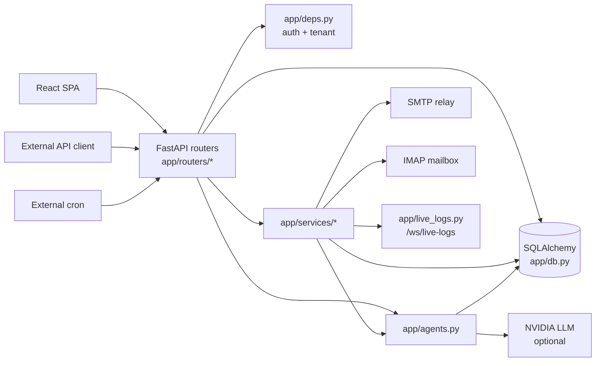
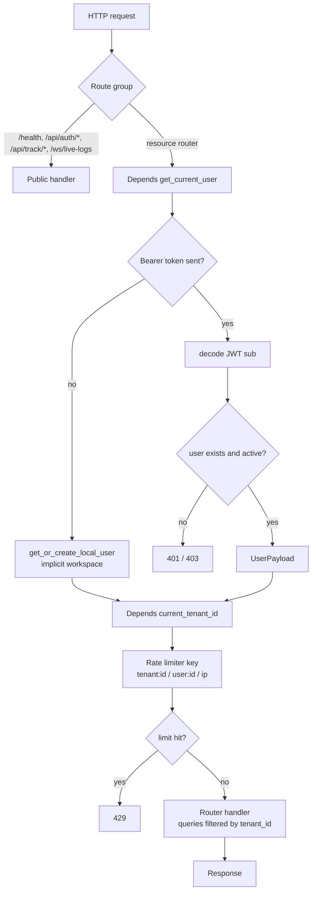
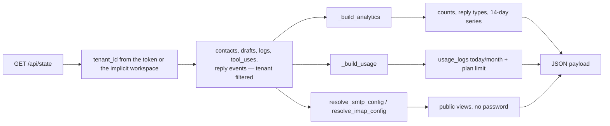
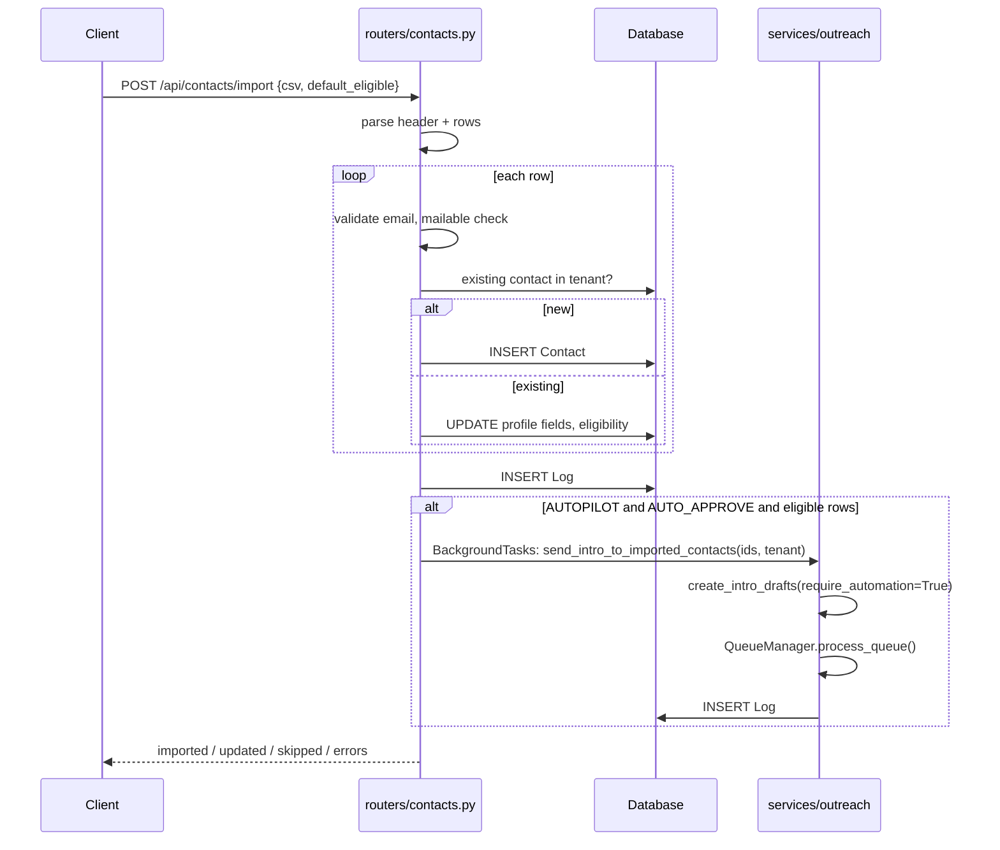
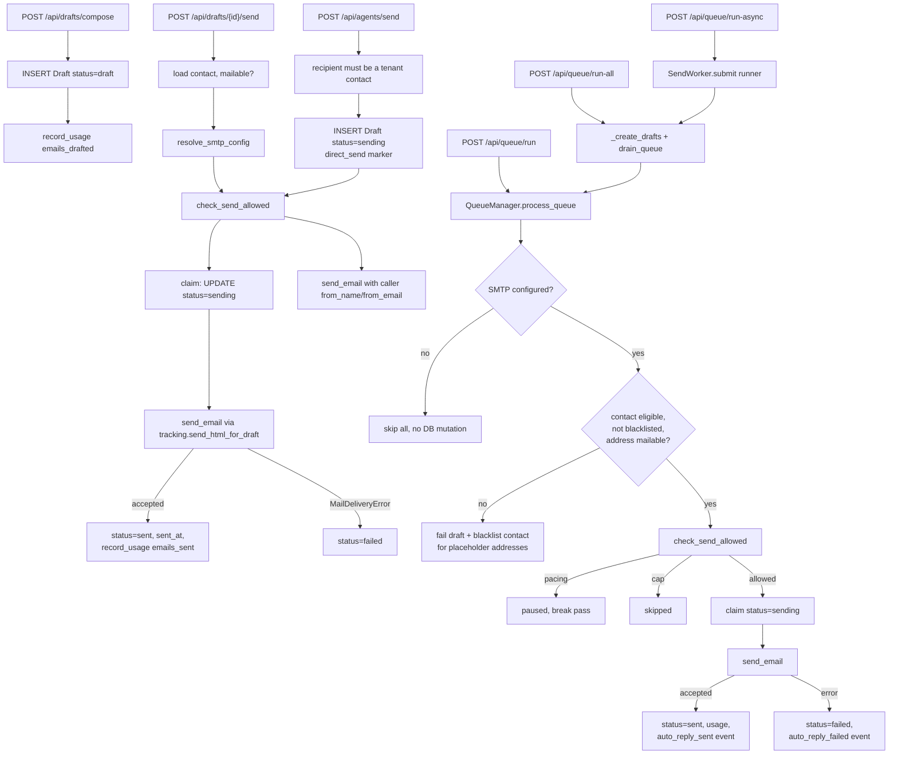
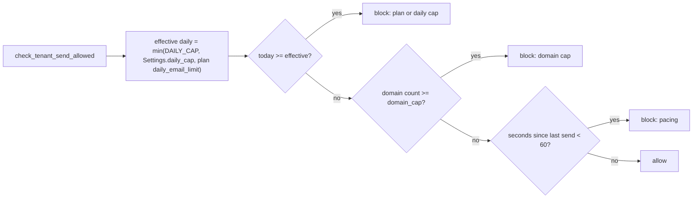
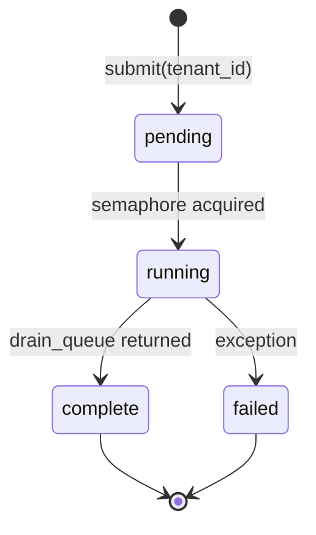
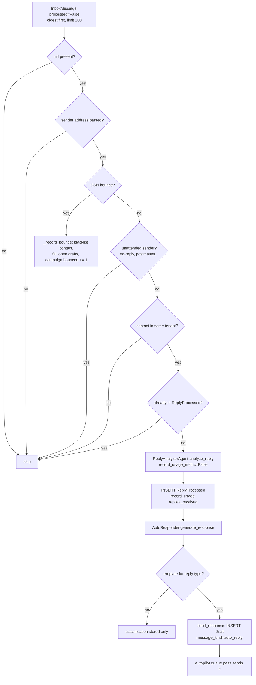
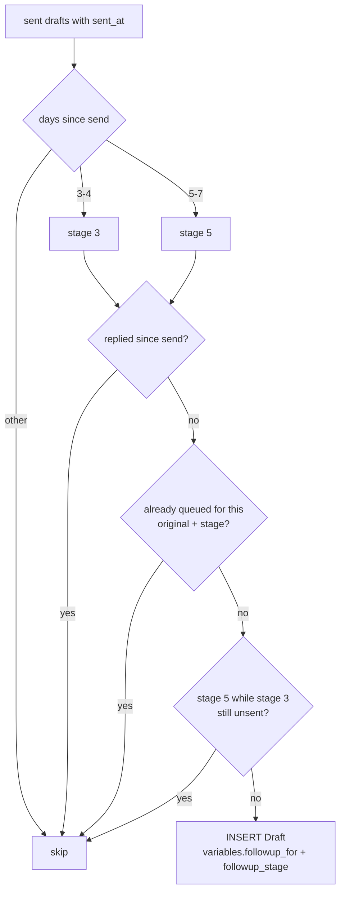
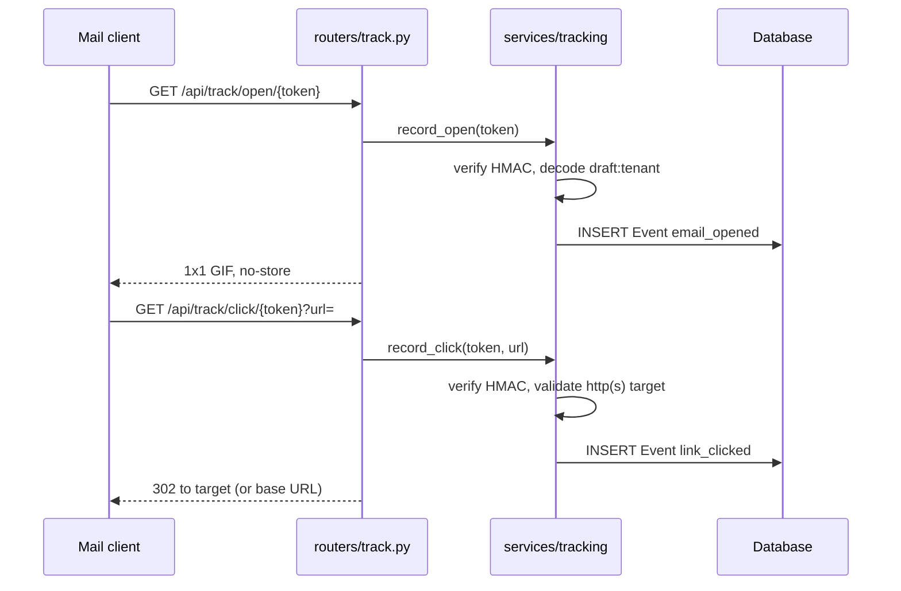

# Backend Flows

How a request moves through the backend: which module handles it, what it calls,
which tables it writes and which external service it touches. This is the
implementation-level companion to [FLOWS.md](FLOWS.md), which describes the
product behaviour; here the focus is module wiring and call order.

Entry point: `app.main:app` (served locally by uvicorn, and on Vercel through the
`api/index.py` adapter). One FastAPI process serves the JSON API under `/api`,
the SPA at `/`, and `/ws/live-logs`.

## 1. Layer map



| Layer | Module | Responsibility |
|---|---|---|
| App / wiring | `app/main.py` | Lifespan, scheduler, rate limiter, `/api/state`, `/api/run`, analytics |
| Auth | `app/auth.py`, `app/deps.py` | JWT issue/verify, local-user fallback, `current_tenant_id` |
| Routers | `app/routers/*.py` | HTTP parsing, tenant scoping, status codes |
| Business logic | `app/services/*.py` | Limits, sending, inbox, follow-ups, outreach, usage, tracking |
| Agents | `app/agents.py` | Personalization, sending wrapper, reply analysis, auto-reply, queue |
| Data | `app/db.py` | Models, session factory, additive schema upgrades |
| Config | `app/config.py` | Environment flags (`LOCAL_*`, caps, `ENABLE_BACKGROUND_JOBS`) |

## 2. Module inventory

| Module | Called by | Talks to |
|---|---|---|
| `main.py` | uvicorn | `db`, `services/*`, `agents`, `routers/api.py` |
| `routers/api.py` | `main.py` | mounts every resource router with `Depends(get_current_user)` |
| `routers/{contacts,drafts,templates,smtp,settings,queue,replies,verifications,inbox,tracking,agents,lists,tenants,scheduling,ab_tests,campaigns}.py` | `routers/api.py` | `services/*`, `agents.py`, `db` |
| `routers/auth.py` | `routers/api.py` (public) | `auth.py`, `db` |
| `routers/track.py` | `routers/api.py` (public) | `services/tracking.py` |
| `services/limits.py` | routers, `agents.QueueManager` | `db` |
| `services/mailer.py` | `agents.py`, `routers/drafts.py`, `routers/agents.py`, `routers/smtp.py` | SMTP |
| `services/inbox.py` | `main.py` scheduler, `routers/inbox.py` | IMAP, `db` |
| `services/outreach.py` | `main.py`, `routers/contacts.py` | `agents.EmailAgent`, `services/recipients` |
| `services/followups.py` | `main.py`, `routers/queue.py` | `agents.expand_template_with_ai`, `db` |
| `services/send_worker.py` | `main.py`, `routers/queue.py`, `routers/scheduling.py` | `agents.QueueManager` |
| `services/usage.py` | send paths | `db.UsageLog` |
| `services/tracking.py` | send paths, `routers/track.py` | `db`, HMAC secret from `auth.py` |
| `services/recipients.py` | every send/draft path | none (pure checks) |
| `services/provisioning.py` | startup, registration | `db` |
| `services/bounces.py` | reply pipeline | pure parsing (DSN detection) |
| `services/verification.py` | `routers/verifications.py` | DNS/SMTP probes |
| `services/abtesting.py` | `routers/ab_tests.py`, `routers/queue.py` | `db` |
| `live_logs.py` | `@instrument_agent` classes | in-memory subscriber queues |

## 3. Startup and shutdown

```mermaid
sequenceDiagram
    participant P as Process
    participant M as lifespan (main.py)
    participant D as db.py
    participant PR as services/provisioning
    participant S as AsyncIOScheduler

    P->>M: start
    M->>D: init_db() (create_all + _ensure_columns)
    alt database reachable
        M->>M: _bootstrap_database()
        M->>D: drafts with status=sending become failed, "interrupted by server restart"
        M->>PR: provision_tenant_defaults() per tenant
        alt ENABLE_BACKGROUND_JOBS
            M->>S: add inbox_poll (IMAP_POLL_MINUTES)
            M->>S: add autopilot (5 min)
            M->>S: start()
        end
    else database unreachable
        M->>M: log; keep serving, /health returns 503
    end
    P->>M: shutdown
    M->>S: shutdown(wait=False)
```

`init_db()` is additive: `Base.metadata.create_all` plus `_ensure_columns()`,
which adds `tenant_id` to legacy tables, backfills them to the first tenant,
re-creates missing columns and rescopes `UNIQUE(uid)` to `UNIQUE(tenant_id, uid)`.

Provisioning is idempotent and creates a `Settings` row, blank `SMTPConfig` and
`IMAPConfig` rows, and starter `intro` / `followup` templates. Only the implicit
workspace inherits `SMTP_*` / `IMAP_*` from the environment
(`inherit_environment=True`), which is why an extra registered tenant with no own
relay cannot send.

## 4. Request gate chain



`routers/api.py` attaches `Depends(get_current_user)` at the router level, so a
new endpoint in an existing resource router is protected by default. The auth
router and the tracking router are mounted without that dependency on purpose.

`current_tenant_id()` rejects a payload with no tenant (403) instead of running
an unscoped query.

## 5. Dashboard read path (`GET /api/state`)



Invalid rows are skipped (validation error logged) rather than failing the whole
payload, so one bad legacy record cannot blank the dashboard.

## 6. Contact import



The import route is synchronous except for the optional outreach task, which
runs after the response has been handed to the client.

## 7. Draft and send paths

Every send path ends in `services/mailer.send_email` and passes
`check_tenant_send_allowed` before it. The one wrapper that can bypass the check
is `agents.EmailAgent.run()`, which sends inline when called with
`auto_approve=True, send_via_smtp=True`; the automatic outreach path calls it with
both false so the queue owns delivery, and no route calls it that way.



`services/limits.py` is the single gate:



Warm-up ramp: days 1–3 → 5/day, 4–7 → 10, 8–14 → 30, then 50. A blocked check
never mutates the draft; the queue treats `Pacing` as "stop this pass" and any
other reason as "skip this draft".

Every draft is claimed with a conditional `UPDATE ... WHERE status IN
('draft','blocked')` before SMTP runs, so two concurrent senders cannot deliver
the same row.

## 8. Async send worker



`SendWorker` bounds concurrency with `SEND_CONCURRENCY` (default 2) and keeps at
most 200 jobs, evicting finished ones. Jobs live in process memory, so a restart
forgets them; `GET /api/queue/jobs/{id}` returns 404 for another tenant's id.

`drain_queue()` calls `process_queue` repeatedly (max 200 passes, 1800 s) and
sleeps out the 60-second pacing gap between passes, so one click delivers the
whole batch while every individual send still passes `check_send_allowed`.

`/api/queue/run-all` drains inline for at most `SYNC_DRAIN_SECONDS` (25 s) when
background jobs are enabled, then hands the remainder to the worker. With
`ENABLE_BACKGROUND_JOBS=false` it drains inline for the full bound instead,
because a handoff to a worker that will not survive the request would drop those
sends.

## 9. Reply and bounce pipeline

Driven by `_process_incoming_replies()` in `main.py`, called from the autopilot
pass and from `POST /api/scheduling/run-now`.



Bounce detection requires a daemon-style sender *and* a DSN marker
(`services/bounces.py`), so a prospect writing "it bounced" is not treated as a
delivery failure. Marking happens before contact matching, because the contact a
bounce matters for is the address named inside the report, not its sender.

## 10. Follow-up pass

`services/followups.generate_followups()` creates drafts only; sending is the
queue's job.



The pass is per tenant; called without a `tenant_id` it sweeps every tenant
separately. `FOLLOWUPS_ENABLED=false` removes the stage from the autopilot pass
entirely.

## 11. Scheduling jobs

| Job | Interval | Entry point | Work |
|---|---|---|---|
| `inbox_poll` | `IMAP_POLL_MINUTES` (min 1) | `main._poll_inbox_job` | `sync_inbox(25, tenant)` per tenant with a resolvable mailbox |
| `autopilot` | 5 min | `main._autopilot_job` | Per tenant opted into `AUTOPILOT` + `AUTO_APPROVE`: draft intros, sync inbox, answer replies, queue follow-ups, drain queue |

Both use `max_instances=1` and `coalesce=True`. Off-request triggering is
`POST /api/scheduling/run-now`, which runs the same `_autopilot_pass` and hands
sending to the worker; `POST /api/run` and `POST /api/queue/run-async` are the
other manual triggers.

Autopilot is skipped when `ENABLE_BACKGROUND_JOBS=false` (serverless), leaving
the same work reachable through the routes above and an external cron.

## 12. Tracking endpoints



These are public by design; the signed token is the credential. Tracking is off
unless `Settings.tracking_enabled` is true for the tenant, and auto-reply drafts
are never tracked.

## 13. Where state is written

| Action | Tables written |
|---|---|
| Register / first local run | `tenants`, `users`, `tenant_members`, `settings`, `smtp_config`, `imap_config`, `templates` |
| Contact import | `contacts`, `logs` (plus `drafts` when outreach runs) |
| Compose / redraft | `drafts`, `usage_logs`, `logs` |
| Manual send | `drafts` (status, sent_at, error_message, attempt_count), `usage_logs`, `logs`, optional `events` |
| Queue pass | `drafts`, `usage_logs`, `logs`, `events` (auto-reply outcomes) |
| Inbox sync | `inbox_messages`, `logs` |
| Reply processing | `inbox_messages.processed`, `replies_processed`, `events`, `usage_logs`, `drafts` |
| Bounce handling | `contacts` (blacklist), `drafts` (failed), `campaigns.bounced`, `logs` |
| Follow-ups | `drafts`, `logs` |
| Open / click | `events` |
| Settings / SMTP / IMAP | `settings`, `smtp_config`, `imap_config`, `logs` |

Every tenant-owned table carries `tenant_id` and every router query filters on it.
The exceptions are the platform tables: `tenants` is the tenant itself, `api_keys`
belongs to a user (whose row carries the tenant), and `usage_logs` is keyed by
`tenant_id` but is written only through `services/usage.py`.

## 14. Error mapping

| Condition | Behaviour |
|---|---|
| Missing/invalid JWT | 401 |
| Deactivated user, user without tenant | 403 |
| Cross-tenant id (contact, draft, list, campaign, job) | 404 |
| SMTP not configured | Draft `blocked`, endpoint 409 / 503 |
| Recipient not eligible or blacklisted | Draft `blocked`, endpoint 409 / 400 |
| Address that can never receive mail | Draft `blocked`/`failed`, endpoint 422, contact blacklisted |
| Daily/plan/domain cap or pacing | 429 for direct send; `skipped`/`paused` in a queue pass |
| Relay rejected the message | Draft `failed` with `error_message`, endpoint 502 / 400 |
| IMAP not configured / unreachable | 400 / 502 on sync routes |
| Rate limiter (per tenant) | 429 |

A draft is only ever marked `sent` after the relay accepted the message, and a
failed send keeps its reason in `error_message` so it is not retried silently.

## 15. Live agent stream

`@instrument_agent` wraps every public method of the agent classes and publishes
`started` / `completed` / `failed` events to `live_logs`. `GET /ws/live-logs`
subscribes an asyncio queue per client. `_outcome()` treats a `(False, reason)`
tuple or `{"success": False}` as `failed`, so a refused send is not reported as a
successful completion. Events are transient: nothing is persisted for this
stream, and reconnecting clients miss what they were not connected for.
