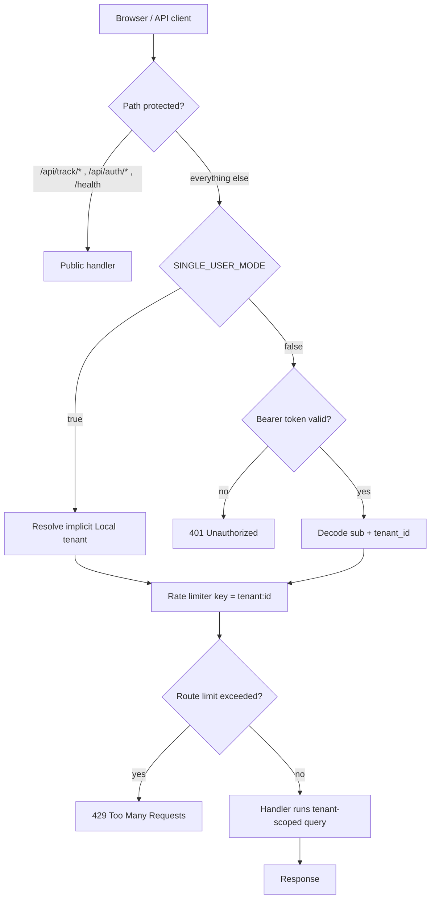
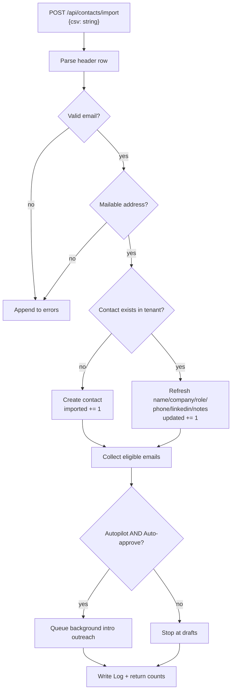
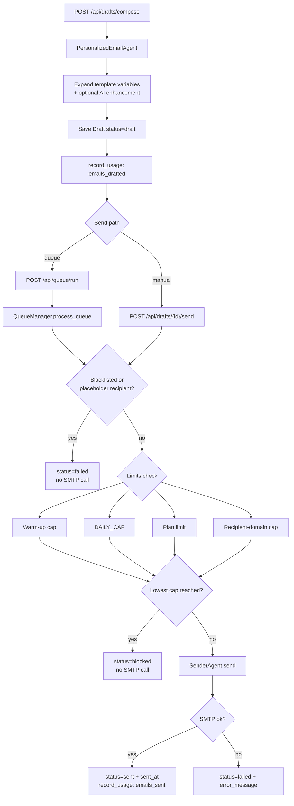
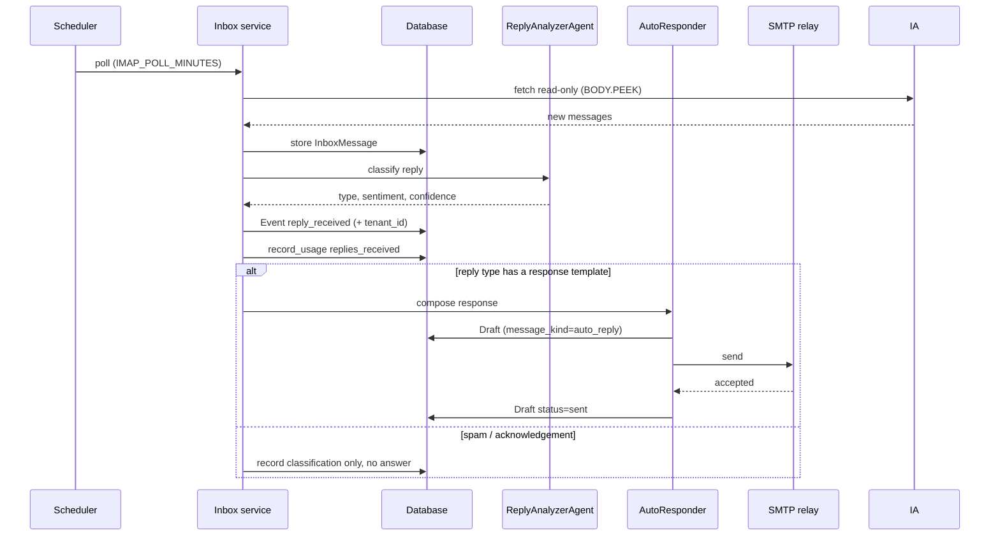
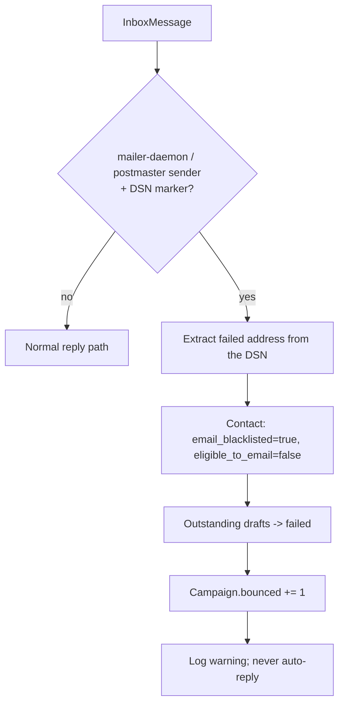
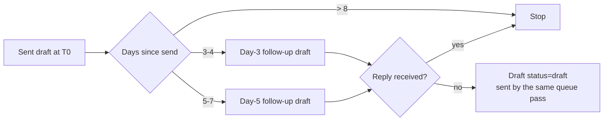
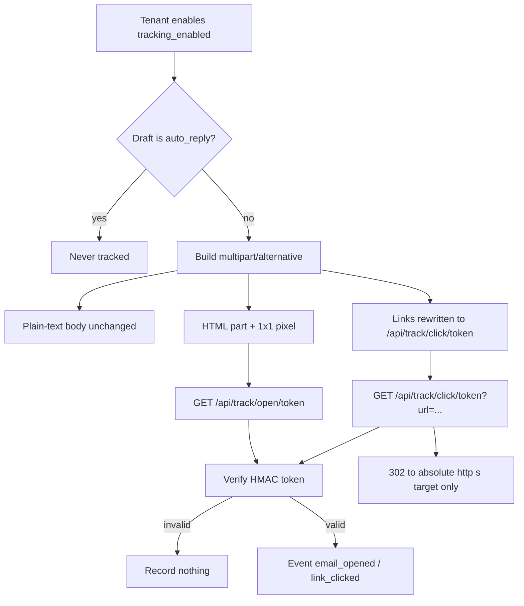
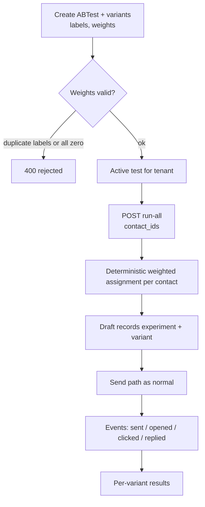
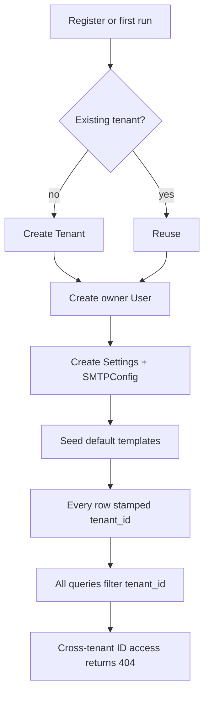
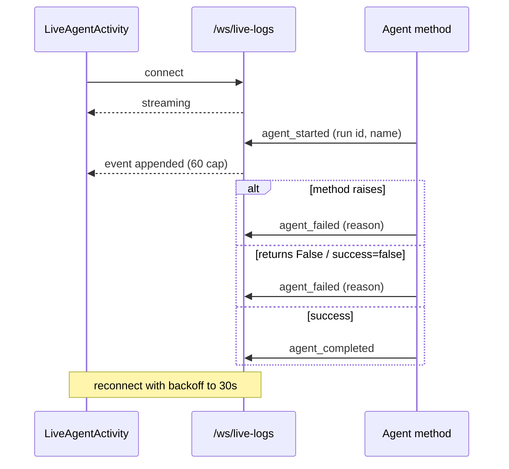

# Core Flows

End-to-end behaviour of the orchestrator: who calls what, which gates apply, and
where state is written. Every flow below is tenant-scoped — `tenant_id` is resolved
from the JWT (or the implicit local tenant when `SINGLE_USER_MODE=true`) and applied
to every query, insert and update.

## 1. Request lifecycle

Every API call passes through the same gate chain before touching business logic.



Sources: `app/auth.py`, `app/deps.py`, `app/main.py` (`_rate_limit_key`, `limiter`).

## 2. Contact import



The response reports `imported`, `updated`, `skipped` and `errors` as mutually
exclusive buckets, so a re-import of the same file returns `imported: 0`.

Eligibility is opt-in: a contact is only mailable when `eligible_to_email` is true,
which requires `email_permission=true` in the CSV (or the toggle in the UI).

The second gate (`C2`) is `services/recipients.blocked_reason`: reserved domains
(`example.com`, `*.test`, `localhost`), disposable inboxes and mail-system
mailboxes are rejected with a reason in `errors`, so a placeholder row can never
become an autopilot target. `BLOCK_PLACEHOLDER_RECIPIENTS=false` disables it.

## 3. Draft and send pipeline



The effective cap is `min(warm-up, DAILY_CAP, plan_limit, domain cap)` — see
`app/services/limits.py`. A draft never flips to `sent` unless SMTP actually
accepted the message.

Both send paths also refuse a recipient that cannot receive mail (see
`services/recipients.blocked_reason`) and a contact blacklisted by a bounce. Such
a draft becomes `failed` with the reason in `error_message`, so it is not retried
on the next pass.

## 4. Reply detection and auto-response



Inbox polling is read-only and never marks mail as read. Follow-up drafting stops
for any contact that has replied.

Nothing in this path waits for a human. `AutoResponder.RESPONSE_TEMPLATES` only
covers `positive_response`, `question` and `schedule_call`, so a negative, spam or
acknowledgement reply is classified and stored but never answered.

### Delivery failures



A bounce is the only hard evidence that a mailbox is dead, because the relay
accepts the message before it knows. Once blacklisted, the contact is excluded
from intro drafting, queue selection and every direct send, and existing drafts
are failed rather than retried. Detection requires a daemon sender *and* a DSN
marker, so a prospect writing "your message wasn't delivered" is not mistaken for
a bounce.

## 5. Follow-up scheduling



Follow-ups create drafts only — the queue sends them on its next pass, so no manual
approval step exists. `FOLLOWUPS_ENABLED=false` disables the whole stage.

## 6. Engagement tracking (opt-in, off by default)



Tokens are signed HMACs over draft and tenant id, so a public endpoint cannot
attribute an open or click to another tenant. With tracking disabled, outbound mail
is plain text with no HTML part at all.

## 7. A/B experiments



Assignment is deterministic per contact, so re-running does not shuffle variants
between sends.

## 8. Usage metering and plan limits

```mermaid
flowchart LR
    A[emails_drafted] --> D[usage_logs]
    B[emails_sent] --> D
    C[replies_received] --> D
    D --> E["GET /api/usage<br/>(today + month)"]
    D --> F["/api/state.usage"]
    E --> G[UI: Sent today X / cap]
    F --> G
    G --> H{At cap?}
    H -- yes --> I[Send blocked with<br/>"Plan limit reached" ]
    H -- no --> J[Sending continues]
```

Three counters are recorded at the moment of the action, not derived afterwards:
drafting, sending, and reply receipt. The Overview progress bar turns red at the cap.

## 9. Tenant provisioning and isolation



In single-user mode the lifespan hook provisions one `Local` tenant and adopts any
legacy rows whose `tenant_id` is NULL.

## 10. Live agent activity stream



Outcome classification lives in `app/live_logs.py::_outcome`, so a tuple of
`(False, reason)` or a dict `{"success": False}` reports `failed`, not `completed`.
